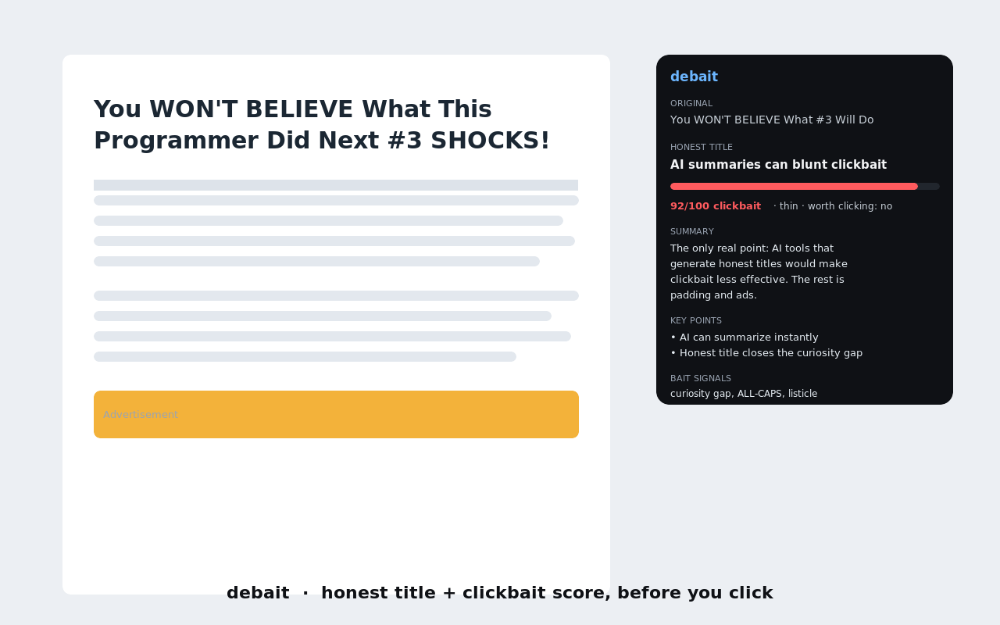

# outsmarting-clickbait 🪝🚫

> **New in v0.3.0 (GitHub/source release; store rollout is separate):** Custom / OpenAI-compatible
> requires an explicit base URL and model; key optional. Keyless remote HTTP
> sends article content and prompts **UNENCRYPTED**. Trust the endpoint operator.
> See the [custom setup, security and userscript compatibility guide](docs/custom-provider.md).
> Userscript custom is limited to Tampermonkey ≥4.18 on Chromium with the
> DOM-isolated sandbox and CORS-compatible direct Fetch; no GM/page fallback.


[](https://github.com/smailzhu/outsmarting-clickbait/actions/workflows/ci.yml)
[](https://github.com/smailzhu/outsmarting-clickbait/releases/latest)
[](LICENSE)

**English** | [繁體中文](README.zh-TW.md) | [台語（漢羅）](README.tai-gi.md)

[](https://chromewebstore.google.com/detail/pcjbpicieggjfjldoekdeglnjhcdhjla?hl=en)

A tiny prototype of the idea from Wiwi Kuan's post
[*"Outsmarting Clickbait"* (騙點閱)](https://www.wiwi.blog/blog/outsmarting-clickbait/):

> Clickbait only works on humans. An AI can read the whole article in a second
> and hand you an honest, non-sensational title plus the actual substance — so
> the bait loses its power.



<sub>_Illustration of the result panel. (Capture from a real browser session welcome — see [`store/STORE_LISTING.md`](store/STORE_LISTING.md).)_</sub>

Ships in three forms from one shared prompt:

| Form | Where | Entry |
|------|-------|-------|
| **CLI** | terminal (OpenAI API or `codex` CLI) | `src/cli.js` |
| **Userscript** | native GM providers; custom restricted | [`userscript/`](userscript/) |
| **Extension** | Chromium (MV3): Chrome / Edge / Brave | [`extension/`](extension/) |

The prompt + result parsing live once in [`shared/prompt.js`](shared/prompt.js);
the browser builds reuse it. **Most named hosted providers require their own API
key; local Ollama and custom endpoints can be keyless** — the `codex` CLI backend is CLI-only.

`debait` fetches an article, reads the whole thing with an LLM, and prints:

- an **honest title** (no hype, no curiosity gap),
- a short **summary** + **key points**,
- a **clickbait score** (0–100) and the **bait techniques** detected,
- a **substance verdict** (`substantial` / `thin` / `empty`) and whether it's
  actually **worth clicking**.

## Does the underlying idea hold up?

Partly — and that nuance is baked into the tool's output. It genuinely defeats
the **curiosity-gap mechanic** for anyone who uses it (that's the honest title +
`worth_clicking` flag). What it *doesn't* do is remove the **economic
incentive** to make clickbait, guarantee truth (a faithful summary can faithfully
repeat false claims — hence the "attribute, don't assert" rule in the prompt),
or stop the adversarial arms race. See [`NOTES.md`](NOTES.md) for the full
critique that motivated the design.

## Install

### Chromium extension (Chrome / Edge / Brave)

**Recommended for Chrome:** open the
[Chrome Web Store listing](https://chromewebstore.google.com/detail/pcjbpicieggjfjldoekdeglnjhcdhjla?hl=en)
and click **Add to Chrome**. No Developer mode or ZIP download is needed.
Pin debait from the browser's extensions menu, then open **Settings** and choose
a provider with your own API key, or a configured local model.

#### Manual installation (alternative / development builds)

1. Download **`debait-extension-v*.zip`** from the
   [latest release](https://github.com/smailzhu/outsmarting-clickbait/releases/latest)
   and **unzip** it. (Or clone the repo and use the `extension/` folder.)
2. Open `chrome://extensions` (or `edge://extensions`, `brave://extensions`).
3. Turn on **Developer mode**, click **Load unpacked**, and select the unzipped
   folder (the one containing `manifest.json`).
4. Click the 🪝🚫 toolbar icon → **Settings** → pick a provider, paste your
   API key, Save. Then **Analyze this page**, right-click → *debait this page*,
   or your **chosen hover mode** on a link to preview it before clicking.

> Chromium can't install a raw `.zip` directly — load the unzipped folder as an
> unpacked extension. (Sideloaded extensions show a one-time "Developer mode"
> notice on startup; that's normal.) See [`extension/README.md`](extension/README.md).

**Right-click a link:** choose **debait this link** to analyze its target without
opening it. Results appear in a closable panel; the action shares hover previews’
cache and usage limits. Right-clicking the page still offers **debait this page**
for current-page analysis. See [right-click menu details](extension/README.md#right-click-menu).

## Hover consent and cancellation (v0.4.0)

This source feature is **extension-only**, not a store-rollout claim. Choose
**Shift + hover**, **Alt + hover**, or **Hover without a modifier** in Settings,
then **Save**. New local state without visible saved configuration starts Shift;
existing raw configuration visible at first initialization keeps Alt, and saved
legacy literal `false` keeps Hover without a modifier. Unsaved edits/failed Saves
never change content policy; Discard restores the loaded or successfully saved
selection.
The userscript remains separately **Alt+hover**; manual/right-click is independent.

Missing or invalid local AI configuration shows plain Settings guidance before
any target fetch, provider call or preview quota work; this transient outcome is
not cached. With **Hover without a modifier**, each otherwise eligible,
movement/dwell-qualified link hover may show the setup tooltip until configured.
There is no scanning, preloading, automatic Settings opening or linked-site
contact for this outcome. Keyless providers can pass local preflight and still
fail generically on hover when unreachable; saving settings does not validate a
key. The manual right-click link action shares the dismissible setup outcome.
The owner confirmed the main Shift checks on Windows/Edge, and three-locale
setup-tooltip layout passed in Chromium. Advanced lifecycle, failure-injection,
and assistive-technology coverage remain incomplete; see
[documented verification risks](docs/hover-activation.md).

Hold Shift and **move physically over a link**. Pressing Shift alone NEVER starts
preview, even at dwell 0, while typing, or with a resting pointer. Alt alone can
start on a recorded stationary link only on a trusted fresh release/repress,
nonrepeat, with readable noneditable focus and no observed shortcut/composition.
Shift/Alt movement uses only the selected key (mixed modifiers remain allowed).
Observed typing/composition or focus entering editable/uncertain contexts cancels
Shift interests and keyboard-origin Alt, without reviving movement credit.
Deliberate subsequent new Shift movement can start again even in editable focus.
No key interception or focus movement: hover, do not click. **Shift+click may open
a new window**; Alt release can expose menus. Shift does not remove every OS shortcut.

Preferences resolve exact case-sensitive `hoverActivation: shift|alt|none` first;
any malformed present canonical value safely requires Shift, not Hover without a
modifier. Without
canonical, legacy `requireAltForHover` literal false means none; every other present
value means Alt. Explicit Save writes canonical plus the legacy mirror
`requireAltForHover: mode !== "none"` together. Older builds interpret saved Shift
as Alt. Legacy-only updates cannot override a present canonical preference.

Fallback uses **local first-successful snapshot provenance**, not global install
history. A non-secret, write-once local `hoverActivationProvenanceV1` marker is set
under an extension-origin exclusive Web Lock before Options/background automatic
four-field profile migration. Load can write this metadata and existing provider
migration, but NEVER either activation preference. Raw own saved preferences or
provider/profiles/keys/key/base/model/language/customInstructions/uiLang/dwell/
interval/cap classify existing regardless of emptiness; defaults/unrelated usage
are not evidence. Fresh stays Shift after automatic migration and later evidence-
only sync. In particular published **0.3.0 Save had no legacy hover preference**:
if its evidence-only configuration arrives AFTER this device classified fresh,
it stays Shift; choose Alt and Save explicitly to sync an authoritative preference.
Another device/reinstall/local clear classifies its then-visible snapshot anew.

Sync-only clear keeps local fallback. Local-only clear leaves explicit sync
preferences authoritative but missing fallback UNKNOWN; genuine Settings reload
or worker startup can classify again. Full clear with settled empty storage is
fresh. Marker removal cancels fallback hover and locks Options, without automatic
retry/revival/repair. Reload after storage operations settle; external clear during
an already-invoked migration/Save is not cross-area atomic or guaranteed safe.
Malformed present markers are preserved and require Shift. Missing Web Locks,
failed read/write/lock or invalidated epoch skips ONLY worker persistent migration;
manual/right-click/current-page analysis still uses existing in-memory provider
normalization. Options editing/Save/Discard/Test Connection stays disabled with
reload guidance. Automatic fallback hover stays silently disabled without known
provenance; explicit known preference plus known dwell can still work independently.
No polling, per-request retries, secret logging or fallback preference writes.

With **Hover without a modifier**, ordinary movement-qualified hover can contact
a linked site and send its URL, title, description and extracted text to your AI endpoint,
using quota and potentially costing money. Keep a comfortable dwell (500 ms is
the default): low dwell, including **0 ms**, can start as soon as eligible movement
rests on a link; 0 is not a cost/privacy bypass and still uses an async timer.
Fetching precedes AI throttle checks; unlimited limits cannot prevent all contacts.
This choice syncs to your sync profile and applies only after Save.

Hover requires a **visible, focused page**, known saved mode/dwell and trusted
input. First positional sample only establishes a screen-position baseline;
child/layout events at equal screen coordinates never start/restart a dwell.
Selected-key release cancels dwell, connected work and displayed success/error;
unrelated release does not. None ignores incidental modifier/typing/focus rules.
Lifecycle/settings changes consume movement credit and never auto-start/retry.
Move again, or use guarded fresh Alt in legacy mode. Browser-reported screen
movement is **not hardware-action attestation** or a prediction of future keys.

Moving away, changing/removing the link, scroll, pointerdown/contextmenu, blur,
hidden visibility and pagehide withdraw only that hover port's interest. The
worker aborts target preparation if its last owner leaves before AI dispatch;
another hover or manual owner of the same URL keeps shared work alive. It checks
interest after awaited preparation and before provider invocation. This is
**worker-observed cancellation**: a disconnect still in IPC transit can lose the
dispatch race. It cannot undo a linked-site contact, a sent AI request or cost.
Cancellation during a durable quota reservation can still consume one unit and
the interval slot even with no AI call; no rollback/refund is promised. After
dispatch, work continues: successful, nonstale results can be cached for 30 minutes
even after all hover owners leave, so a later same-configuration cache hit needs
no new target fetch, AI request or quota. Errors/stale/canceled-pre-dispatch jobs
are not cached; successful thin-fetch metadata stays free and cacheable.

No link scanning or preloading is added. One active hover observes subtree
removals and href changes during dwell, preparation and displayed results,
validating one captured anchor and relevant records. Document-wide mutation
observation can still cost CPU on busy pages. Native Chromium port lifetime,
service-worker suspension/reload, bfcache, layout-event behavior, accessibility
and physical Windows/Edge Shift/Alt behavior require browser checks; Node fixtures do not attest them.

**Check your connection:** in extension **Settings**, click **Test connection**
under the model field. It uses the current, unsaved provider/key/model/base URL
and makes one small generation request (quota or charges may apply). No article
content is sent. A successful test means the model returned text; a 429 indicates
quota/rate limits, not necessarily an invalid key. Tests are outside the preview
cap. See [the connection-test guide](extension/README.md#test-your-provider-connection).

### Userscript (native providers via GM; custom has restricted environment)

Install a userscript manager, then open
[`userscript/debait.user.js`](userscript/debait.user.js) → **Raw** — your manager
offers to install it. Set provider/key from the Tampermonkey menu.
See [`userscript/README.md`](userscript/README.md).

### CLI

No dependencies. Needs Node ≥ 20.

```bash
git clone https://github.com/smailzhu/outsmarting-clickbait.git
cd outsmarting-clickbait
npm link        # optional: puts `debait` on your PATH
```

## Usage

```bash
# From a URL
debait https://example.com/some-viral-article

# JSON output (for piping / integration)
debait https://example.com/some-viral-article --json

# From raw HTML on stdin (great for testing / paywalled pages you already have)
cat examples/sample-clickbait.html | node src/cli.js --stdin --url https://example.com/x
```

### Providers / backends

Multi-provider, from one shared layer ([`shared/providers.js`](shared/providers.js)):

| Provider | id | Wire format | Default model | Key env |
|----------|----|-------------|---------------|---------|
| OpenAI | `openai` | openai | gpt-4o-mini | `OPENAI_API_KEY` |
| Anthropic (Claude) | `anthropic` | anthropic | claude-3-5-haiku-latest | `ANTHROPIC_API_KEY` |
| Google Gemini | `gemini` | gemini | gemini-flash-latest | `GEMINI_API_KEY` |
| Groq | `groq` | openai | llama-3.3-70b-versatile | `GROQ_API_KEY` |
| OpenRouter | `openrouter` | openai | openai/gpt-4o-mini | `OPENROUTER_API_KEY` |
| DeepSeek | `deepseek` | openai | deepseek-chat | `DEEPSEEK_API_KEY` |
| xAI (Grok) | `xai` | openai | grok-3 | `XAI_API_KEY` |
| Mistral | `mistral` | openai | mistral-small-latest | `MISTRAL_API_KEY` |
| Together | `together` | openai | meta-llama/Llama-3.3-70B-Instruct-Turbo | `TOGETHER_API_KEY` |
| NVIDIA (NIM) | `nvidia` | openai | meta/llama-3.3-70b-instruct | `NVIDIA_API_KEY` |
| Ollama (local) | `ollama` | openai | llama3.1 | — |
| Custom / OpenAI-compatible | `custom` | openai | explicit, no default | `CUSTOM_API_KEY` (optional) |
| Codex CLI | `codex` | — (shells out) | — | — |

**CLI auto-selection:** the first provider whose key env var is set, else the
[`codex`](https://developers.openai.com/codex) CLI. Override:

```bash
debait <url> --backend anthropic        # or: DEBAIT_PROVIDER=anthropic
export ANTHROPIC_API_KEY=...             # provider key
DEBAIT_MODEL=claude-3-5-sonnet-latest    # override model
DEBAIT_BASE_URL=https://my-gateway/v1    # override base (gateways / local)
DEBAIT_BACKEND=codex                     # force the codex CLI
```

**Output language.** By default the honest title + summary come back in the
article's own language (`auto`). Force one with `--lang` / `DEBAIT_LANG`:

```bash
debait <url> --lang English
debait <url> --lang "繁體中文"      # or 日本語, Español, es, ...
DEBAIT_LANG="繁體中文" debait <url>
```
**Custom instructions.** Steer the model with your own text, appended to the
prompt — e.g. “be harsher on sensational framing”, “focus on political spin”,
“add a one-line TL;DR”. The required JSON output shape is always preserved
(instructions are sandwiched + capped at 2,000 chars), so parsing never breaks.

```bash
debait <url> --instructions "Be harsher. Add a one-line TL;DR."
DEBAIT_INSTRUCTIONS="Focus on political spin" debait <url>
```
Extension: Options → *Custom instructions*. Userscript: menu → *set custom instructions*.

JSON keys and the `substance_verdict` enum always stay English. The extension
(Options → Output language) and userscript (menu → *set output language*) expose
the same setting.

The userscript and extension expose the same provider list in their settings.
After editing `shared/providers.js`, run `npm run sync` to copy it into the extension and generate the userscript custom helpers.

## Example

```bash
$ cat examples/sample-clickbait.html | node src/cli.js --stdin
ORIGINAL:  SHOCKING: This ONE Feature Could DESTROY The Entire Media Industry Forever
HONEST:    Developer suggests AI summaries could make clickbait less effective
Clickbait  ████████████████░░░░ 85/100
Substance  thin   worth clicking: false
Summary:   The article's only real point is that AI tools generating honest
           titles/summaries would reduce clickbait's effectiveness. The rest is
           padding and ads.
```

## How it works

```
URL ──▶ extract.js ──▶ summarize.js ──▶ llm.js ──▶ honest title + score
        (fetch +         (prompt +        (openai |
         strip HTML)      JSON parse)      codex CLI)
```

Extraction is deliberately dependency-free and heuristic (strip
`script/style/nav/aside/footer`, prefer `<article>`). For production you'd swap
in Readability + a headless browser for JS-rendered pages.

## UI language (i18n)

Two independent things:

- **Output language** (the honest title + summary) — chosen by you, any
  language, via the `language` setting / `--lang` (see Providers above).
- **Interface language** (buttons, labels, tooltips) — the extension uses
  Chrome's native i18n and currently ships **English** and **繁體中文**
  (`extension/_locales/`); it follows your browser UI language. The userscript
  overlay auto-selects en/zh_TW from `navigator.language`.

Add a locale by copying `extension/_locales/en/messages.json` to
`extension/_locales/<code>/messages.json` and translating the values.

## Privacy & keys

Full policy: [PRIVACY.md](PRIVACY.md). Chrome Web Store listing material: [store/STORE_LISTING.md](store/STORE_LISTING.md).

- **Your API key stays yours.** The CLI reads it from an env var; the extension
  stores it in `chrome.storage.sync` (synced to your browser profile, not to us);
  the userscript stores it via your userscript manager. It is sent only to the
  provider endpoint you configure — there is no debait server.
- **What's sent to the provider:** the page's URL, title, meta description, and
  extracted text (capped at ~12,000 characters) of the page you debait (or
  link-preview), so the model can summarize it. Nothing else.
- **Extension host access:** the extension requests broad host permissions
  (`https://*/*`, `http://*/*`) so the background worker can fetch the *target* of
  a hovered link for preview. It fetches on eligible saved-mode hover (Shift
  hold-and-move for new local state; Alt/none selectable) or manual link analysis.
- **Cost control:** hover previews are rate-limited (one at a time, min interval)
  with a 429 backoff and a configurable **daily cap** to limit provider attempts.
  Interval and cap can be unlimited and do not prevent linked-site contacts.
  See each surface's settings.

## Test

```bash
npm test
```

## Contact

No GitHub account? Email the author at **cusp-preacher-blot [at] duck [dot] com**
(swap “[at]” → “@”, “[dot]” → “.”), or open an
[issue](https://github.com/smailzhu/outsmarting-clickbait/issues). In the extension,
see **Options** for a one-click contact link.

## Setup help, source context and dismissal

Settings offers static, opt-in official API-key help links for Anthropic, Gemini,
Groq, OpenRouter, xAI, Together and NVIDIA. OpenAI, DeepSeek and Mistral currently
have local dashboard/documentation guidance instead of unverified links. Custom
endpoints get operator/key-optional guidance; local Ollama needs no key. Help
follows the visible selection, including unsaved switches. Clicking a help link
opens a new tab; merely viewing/switching/rerendering help does not navigate,
collect keys, save settings or make a provider request. Sign-in/key acquisition
workflows have not been authenticated or browser-validated, and official URLs
and redirects can change.

Current-page extension/userscript panels show the captured requested hostname
only, not a duplicate-page link. An extension's explicit link analysis also has
**Open requested article**: a normal new-tab link to the captured requested URL,
not a model URL or a verified final origin/publisher. Fetches and navigation may
redirect. Labels never include credentials, paths or query/fragment values; the
navigation URL retains legitimate query/fragment values already present (which
may themselves contain tokens). No stored/form secrets are appended. If source
validation rejects a URL, only this decorative row/link is hidden; existing
preview eligibility, canonical request URLs and analysis remain unchanged.

The ✕ button remains available in every panel state. Trusted, unmodified Escape
can also dismiss when focus is on the panel or neutral document body/root (or
no element); the userscript additionally recognizes only the launcher button it
actually created, by identity. Other page buttons, links, editors and widgets
are ineligible. Chromium right-click can leave focus on the requested page link,
so Escape may do nothing until focus becomes eligible; use ✕ or Tab into the
panel. No focus trap, autofocus or explicit focus restoration is added.

Fullscreen, open dialogs, any `[aria-modal="true"]` (even hidden/stale), and open
popovers in the document/reachable open shadow roots veto Escape, including
panel/launcher focus. Read-only checks stop at 10,000 elements, 100 roots (the
document counts as one), and 100 focused elements: exhausted budgets, unsupported
popover selectors or access errors disable Escape for that event. Hidden/stale
modal markers can disable it indefinitely. Closed shadow overlays cannot all be
inspected; focused opaque custom roots are vetoed. Top-frame Escape does not
handle iframe events. ✕ is the fallback for all these conservative limits.
Native focus, IME, popovers, shadow behavior and new-tab/noreferrer handling
still need real-browser checks; no screenshot/manual accessibility claim is made.
The panel's sole window Escape listener is bubble-phase and never prevents the
default or stops propagation. Earlier page handlers can veto it; later window
handlers do not have guaranteed priority. Userscript Alt behavior is unchanged; extension hover follows its saved mode.
Closing suppresses late display, not already-dispatched work or incurred usage;
it does not cancel or refund provider requests.

## License

MIT
